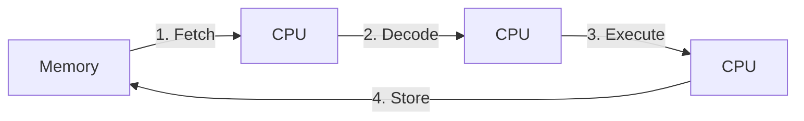
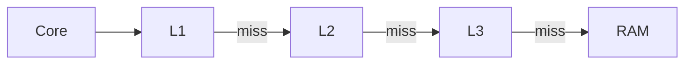
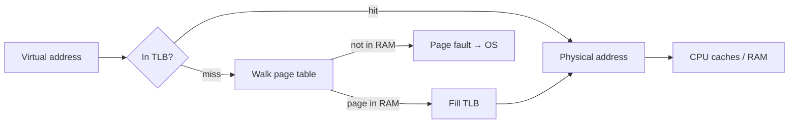

# Computer Architecture

## Terminology

### Hardware

The physical components of a computer system.

Examples:

- CPU
- RAM
- SSD
- GPU
- Keyboard
- Network card

Hardware performs computation and other physical operations under the control of software.

### Software

The broad term for instructions and data that tell computer hardware what to do. Software is non-physical; it is stored as data and instructions on hardware.

Examples of software include:

- Operating systems
- Applications
- Firmware
- Device drivers
- Utilities

### Firmware

A specialized type of software that provides low-level control and is closely tied to a particular piece of hardware.

Firmware is typically stored in non-volatile memory associated with the device.

Examples:

- BIOS/UEFI firmware on a motherboard
- Firmware inside an SSD
- Firmware inside a router
- Firmware controlling a keyboard or mouse

### Application

Software designed to provide useful functionality to a user or another system.

Examples:

- Google Chrome
- VS Code
- Spotify
- Microsoft Word

For example when launching an application like Chrome The first Chrome process is created when the OS launches Chrome. Then Chrome's running code requests additional child processes from the OS. A typical flow looks like:

```text
User clicks application
        ↓
Operating system is asked to run the program
        ↓
OS loads the program's executable into memory
        ↓
OS creates the application's initial process
        ↓
Application code starts executing
        ↓
That process may ask the OS to create additional processes
```

An application may contain multiple programs/components and may run using one or many processes.

For example:

```text
Google Chrome Application
├── Browser Process
├── Renderer Process
├── Renderer Process
├── GPU Process
└── Utility Processes
```

### Program

A **File** is just bytes of data stored on disk. `.txt`, `.png`, `.jpg`, `.cpp` are all files that just differ in how those bytes are arranged. It is always up to the application consuming the file to determine how to interpret it.

A **program** is an executable file on disk. Example: `.exe` on windows, main on linux or a compiled binary file. A **Binary File** contains instructions/data in a form the computer's processor can directly execute or use, rather than human-readable source code.

Sometimes people also call a source code file like `.cpp` a program but the actual program is the compiled binary that will be formed from it.

### Process

Prcocess is an independent Program in execution. Loaded by the OS kernel when you run a program.

- They are more secure and isolated.
- Communication between processes is slower
- Example: Opening VS Code, Google Chrome, etc.

When a process is running, it has its own memory allocation like the heap, stack, code, data segments and its own process ID to keep track of its status by the OS. At any given instance, The CPU only contains the immediate execution state, mainly:

```
CPU
├── Instruction register / pipeline → current instructions being executed
├── Program counter                 → address of next instruction
├── General-purpose registers       → current values/operands
└── Stack pointer, flags, etc.      → current execution state
```

### Thread

- One Continuous flow of execution of instructions in a process
- Shares memory/ resources with other threads in the same processes.
- Example:

```text
Chrome Process
├── UI Thread
├── Rendering Thread
├── Network Thread
└── JavaScript Thread
```

## CPU

CPU(Central Processing Unit) is one of the core pieces of hardware and is responsible for executing instructions.

### CPU Cores

- A physical unit inside the CPU that executes instructions.
- The OS Scheduler maps threads to cores.
- Normally only one thread executes on a CPU core at any instant of time.
- But **Simultaneous multithreading (SMT)** allows one physical CPU core to process two threads at the same time by presenting itself to the OS as two logical cores. Both threads share the physical core's execution resources, so two logical cores do not provide the same performance as two separate physical cores. Intel's calls its implementation of SMT as Hyperthreading.

#### Single Core CPU

- The OS uses a mechanism called *Context Switching* which allows it to repeatedly switch between different threads by saving the state of one thread and loading another thread onto the core.
- Because the OS does this very quickly, multiple threads appear to make progress during the same period of time which gives us *concurrency*

#### Multi Core CPU

- Since there are multiple cores available, multiple threads truly execute simultaneously and make progress at same instant on different cores which is known as *parallelism*.
- But since multiple threads are also making progress during the same period of time this is also concurrency so its parallelism along with concurrency.

#### Performance and Efficiency Cores

- Many modern CPUs mix two kinds of cores on one chip, called a *heterogeneous* (or hybrid) design:
  - **Performance cores (P-cores):** big, fast, and power-hungry. Used for work the user is waiting on.
  - **Efficiency cores (E-cores):** smaller and slower, but they do the same work for far less energy. Used for background work.
- Both kinds run the same instruction set, so a thread can move between them at any time without being recompiled.
- The idea started on phones as ARM's **big.LITTLE** (2011). Apple has used it since the iPhone's A10 (2016) and on Macs since M1 (2020); Intel since 12th-gen Alder Lake (2021).
- The OS scheduler decides which thread runs on which kind of core. macOS and iOS decide using the thread's **QoS class**: user-interactive work goes to P-cores, and work marked background is kept on E-cores, which saves battery.
- Apple Silicon groups cores of the same kind into **clusters** that share an L2 cache (see [CPU Caches](#cpu-caches)). An M4 has one cluster of 4 P-cores and one of 6 E-cores. `sysctl hw.perflevel0` describes the P-cores and `hw.perflevel1` the E-cores.

### Machine Cycle

Sequence of 4 steps a CPU performs to execute a single machine language instruction.

Example instructions:

- ADD R1, R2 (Add the contents of register R2 to register R1)
- MOV AL, 97 (Put the value 97 into register AL.)



> Not to be confused with a Clock Cycle

**Clock Cycle** is one tick of the CPU's clock. One machine cycle can take several clock cycles and clock cycles differ for different CPUs depending on their frequency (Old Intel: 5MHz, Modern Intel: 3-5GHz).

### CPU Caches

Step 1 of the machine cycle fetches from memory, but RAM is far too slow to keep up with the CPU. One RAM read takes about 100 ns, and in that time a modern core could run hundreds of instructions. To hide that gap, the CPU keeps copies of recently used memory in small, fast **caches** on the chip itself.



When a core needs the data at some address:

1. It checks **L1**, the smallest and fastest cache. If the data is there, that's a **cache hit**, and it arrives in a few cycles.
2. On a **cache miss**, it checks **L2**, then **L3**. Each level is bigger but slower.
3. If every level misses, the data comes from **RAM** and is copied into the caches on the way back, so the next access to it hits.

| Level | Typical size | Shared by | Approx. latency |
|-------|--------------|-----------|-----------------|
| L1 | 32–128 KB (split into instruction and data caches) | One core | ~1 ns |
| L2 | 1–16 MB | One core on x86, a cluster of cores on Apple Silicon | ~3–5 ns |
| L3 | Tens of MB | All cores | ~10–20 ns |
| RAM | GBs | The whole system | ~100 ns |
| SSD | Hundreds of GB – TBs | The whole system | ~100 µs |

Apple Silicon has no L3. Its last level is a **System Level Cache (SLC)** shared by the CPU, GPU, and Neural Engine. On an M4 (`sysctl hw.perflevel0` and `hw.perflevel1` show these):

- Performance cores: 128 KB L1 data cache each, 16 MB L2 shared by the 4 P-cores.
- Efficiency cores: 64 KB L1 data cache each, 4 MB L2 shared by the 6 E-cores.

#### Cache Lines

- Caches don't store single bytes. Memory moves between RAM and the caches in fixed-size blocks called **cache lines**: 64 bytes on most x86 CPUs, 128 bytes on Apple Silicon (`sysctl -n hw.cachelinesize` prints `128`).
- Reading one byte loads its whole line, so the neighboring bytes come along for free.
- A cache line is to the CPU caches what a [page](#pages-and-frames) is to RAM: the unit everything moves in, just much smaller (64–128 B vs 4–16 KB).
- Writes usually stay in the cache. A written line is marked **dirty** and only written back to RAM when it's evicted, the same idea as [dirty pages](#reclaiming-memory-clean-dirty-compressed-and-swapped-pages).

#### Why Caches Work: Locality

Caches are tiny compared to RAM, yet most accesses hit, because programs don't touch memory randomly:

- **Temporal locality:** data used recently is likely to be used again soon (a loop counter, the top of the stack). Caches keep recently used lines around.
- **Spatial locality:** data near something just used is likely to be used next (the next array element, the next instruction). Loading whole lines means the neighbor is already there, and the **hardware prefetcher** spots sequential patterns and loads lines before they're asked for.

This is why iterating a contiguous array is fast and chasing pointers through a linked list is slow: the array uses every byte of every line it loads, while each list node can be a fresh miss. [Object Memory Layout](<../DSA/C++/Memory/Object Memory Layout.md#7-why-layout-matters-the-cache>) covers what this means for C++ code.

#### Caches and Multiple Cores

- Each core has its own L1, so the same line can be copied into several cores' caches at once.
- When one core writes to its copy, a **cache coherence** protocol in hardware invalidates the copies in other cores, so no core reads a stale value.
- That invalidation has a cost. If two threads write to different variables that happen to share one line, the cores keep invalidating each other's copy even though the threads never touch the same data. This is **false sharing** (see [Object Memory Layout](<../DSA/C++/Memory/Object Memory Layout.md#false-sharing-multithreading>)).

### Race Conditions

A **race condition** is a software or system flaw where two or more threads, from the same or different processes, try to access and change the same shared data, and the final result depends on the unpredictable order in which they run.

The threads do not need to execute in parallel at the exact same instant. Even on a single CPU core, their steps can interleave during concurrency.

Example:

```python
tickets_left = 1

def reserve_ticket(user):
    global tickets_left

    if tickets_left > 0:         # 1. check shared data
        tickets_left -= 1        # 2. update shared data
        print(f"{user} got a ticket")

# Thread A calls reserve_ticket("A")
# Thread B calls reserve_ticket("B")
```

Possible interleaving:

```text
Initial tickets_left = 1

Thread A checks tickets_left > 0 and passes
Thread B checks tickets_left > 0 and passes
Thread A subtracts 1 and prints "A got a ticket"
Thread B subtracts 1 and prints "B got a ticket"

Two users were told they got a ticket, even though only one ticket existed.
```

The bug is not that the ticket count is wrong by itself. The bug is that `check availability -> reserve ticket -> confirm reservation` was not protected as one indivisible operation.

A **critical section** is the part of code that accesses shared data and must be protected so another concurrent thread cannot interrupt it halfway through.

In the ticket example, the critical section is:

```python
if tickets_left > 0:
    tickets_left -= 1
    print(f"{user} got a ticket")
```

Meaning If one thread is already inside this block, then another thread should not be allowed to enter that same critical section until the first thread finishes it.

#### Locks

A **lock** is a synchronization tool that allows only one thread at a time to enter a protected critical section.

```python
from threading import Lock

tickets_left = 1
tickets_lock = Lock()

def reserve_ticket(user):
    global tickets_left

    with tickets_lock:
        if tickets_left > 0:          # Check shared data
            tickets_left -= 1         # Update shared data
            print(f"{user} got a ticket")  # Confirm the reservation
```

The lock does not make the code faster. It makes the shared-state update correct by forcing the check and write to happen without another thread entering the same protected block.

#### Deadlocks

A **deadlock** happens when concurrent tasks wait on each other forever.

Example:

```text
Thread A holds Lock 1 and waits for Lock 2.
Thread B holds Lock 2 and waits for Lock 1.

Neither thread can continue.
```

Common ways to reduce deadlocks:

- Acquire locks in a consistent order.
- Keep locked sections small.
- Avoid holding a lock while doing slow I/O.
- Use higher-level tools like queues when ownership transfer is clearer than shared mutation.

## Memory

### Process Memory Layout

When a process is started from its executable file on disk, the OS assigns it a virtual address space.

Typical layout for a virtual address space looks like:

```text
High Addresses
+---------------------------+
|           Stack           |
|             ↓             |
+---------------------------+
|                           |
|        Free Space         |
|                           |
+---------------------------+
|             ↑             |
|            Heap           |
+---------------------------+
|   BSS (based on metadata  |
|    from .bss section)     |
+---------------------------+
|  Data (from .data section)|
+---------------------------+
|  Code (from .text section)|
+---------------------------+
Low Addresses
```

#### Code

- Stored in the executable file and loaded into memory when the process starts.
- Contains machine instructions for running the program.
- Raed-only and fixed in size, so nothing can change the code instructions at run time.

Example:

```cpp
#include <iostream>

int main() {
    std::cout << "Hello, World!\n";
    return 0;
}
```

#### Data

- Contains Initialized global and static variables.
- Values are stored directly in the executable file and loaded into memory when the process starts.
- Read/Write accessible
- Fixed in size

Example:

```cpp
int counter = 10;          // Global variable
static int value = 42;     // Static variable
```

#### BSS

- BSS means Block Started by Symbol.
- Contains Uninitialized global and static variables.
- The executable stores metadata describing the required size rather than storing large blocks of zero bytes. The OS creates this region and initializes it to zero when the process starts.
- Read/write accessible.
- Fixed in size

Why a BSS section separate from Data?

```cpp
char logBuffer[100000000]; // 100 MB
```

If this variable were stored in the Data section, the executable would need to contain 100 MB of zero bytes, making the executable unnecessarily large.

Instead .bss contains metadata like:

```text
Reserve 100 MB of zero-initialized memory
```

#### Heap

- Stores dynamically allocated memory at runtime.
- Can grow and shrink during program execution.
- Used when the size or lifetime of data cannot be determined at compile time, or when ownership must extend beyond a particular scope.
- Read/Write accessible.
- Typically grows **upward** toward higher addresses.
- Usually shared by all threads in a process.
- Objects can be manually created and removed using `malloc`/`free` in C, `new`/`delete` in C++, or automatically managed through C++ abstractions such as smart pointers and RAII. High level languages such as python have automatic garbage collectors that free up unused objects.

Example:

```cpp
void example() {
    int* value = new int(42); // Allocates an int on the heap and returns its address for storage in value.

    // delete expects a pointer to an object allocated with new, or nullptr.
    delete value; // Destroys the pointed-to int and releases its memory.
}
```

**Memory Leak:** Occurs when heap memory is allocated but never released, even though the program no longer has any way to use it.

If `delete value;` is omitted in the example above, returning from `example()` ends the local pointer's lifetime but leaves the heap-allocated `int` allocated. Since no other pointer retains its address, the program can no longer access or release that object while it continues running

#### Stack

- Stores **function call frames** (also called activation records).
  - A function call frame contains information needed for a function invocation, including:
    - Local variables
    - Function parameters
    - Return address (where execution should continue after the function returns)
    - Other bookkeeping information used by the compiler and CPU
  - Each function call creates a new frame on the stack.
  - When a function returns, its frame is automatically removed.
- Memory is allocated and released automatically as functions are entered and exited.
- Each thread has its own stack. In Multi threaded processes the modern Stack section is further divided into separate Stacks.
- Read/Write accessible.
- Typically grows **downward** toward lower addresses

```cpp
void example() {
    int age = 42;
    int* value = new int(age);

    delete value;
}
```

`age` and `value` are both local objects, typically stored in the function call's stack frame. `age` stores an integer directly, while `value` stores the address of a separate heap-allocated `int`, initialized with a copy of `age`'s value. Both local objects' lifetimes end automatically when `example()` returns. The heap object is released earlier by `delete value;`.

Visualization before `delete value;`:

```text
Stack                    Heap
+------------+
| age: 42    |
+------------+          +------+
| value -----+--------->|  42  |
+------------+          +------+
```

**Stack Overflow:** Occurs when a program uses more stack memory than is available, usually because of excessive or infinite recursion. Each function call adds a new frame to the stack, and if too many frames are added without returning, the stack runs out of space.

**Segmentation Fault:** A kind of error that happens when a program tries to access memory it's not allowed to use or isn't valid anymore. The word stems from segmentation in memory and a program accessing a wrong segment

```cpp
int* ptr = nullptr;
*ptr = 42;  // Segmentation fault
```

The program attempts to write through an invalid memory address, causing the OS to terminate it.

### Virtual Memory

Every process sees the memory layout above as if it owns one huge, contiguous block of memory starting near address `0`. This is an illusion maintained jointly by the OS and a piece of CPU hardware called the **MMU** (Memory Management Unit).

In reality:

- Physical RAM is limited and shared by **all** processes at once.
- The free frames available in RAM are scattered, not contiguous.
- The total memory demanded by all processes can exceed the physical RAM installed.

**Virtual memory** is the abstraction layer that hides all of this. It gives each process its own private **virtual address space** and translates the virtual addresses the program uses into real **physical addresses** in RAM at runtime.

Why this is useful:

- **Isolation / security:** A process can only name addresses inside its own space. It has no way to even express an address that points into another process's memory.
- **Simplicity:** Every program can be compiled as if it starts at the same fixed address. The compiler and linker never need to know where in RAM the program will actually be placed.
- **Overcommit:** Because virtual addresses are mapped lazily, processes can reserve far more memory than physically exists, as long as they don't use all of it at once.

#### Pages and Frames

- The virtual address space is divided into fixed-size blocks called **pages** (commonly 4 KB on x86-64 and Linux, and 16 KB on Apple Silicon Macs and iOS devices).
- Physical RAM is divided into equally sized blocks called **frames**.
- Any virtual page can be placed in any physical frame. The seemingly contiguous pages of one process do **not** need to land in contiguous frames.

#### Page Table

- Each process has its own data structure called Page Table, maintained by the OS that maps a **virtual page number → physical frame number**.
- Because the table is per-process, the *same* virtual address in two different processes maps to *different* frames. This is what makes isolation work.

#### TLB (Translation Lookaside Buffer)

The page table is stored in RAM. If the MMU had to read it on every memory access, each load would first need extra RAM reads just to find the physical address. And it's more than one extra read: on 64-bit systems the page table is a tree several levels deep (4 on x86-64), so one lookup, called a **page-table walk**, can take several reads.

The fix is the same idea as the [CPU caches](#cpu-caches): the **TLB** is a small cache inside the MMU that holds recently used **virtual page → physical frame** translations.



On every memory access:

1. The CPU issues a virtual address. The MMU splits it into a **virtual page number** (the high bits) and an **offset** within the page (the low bits: 12 bits for 4 KB pages, 14 for 16 KB).
2. The MMU looks up the page number in the TLB.
   - **TLB hit:** the frame number comes back almost immediately.
   - **TLB miss:** the MMU walks the page table to find the entry, then stores it in the TLB for next time.
3. Frame number + offset gives the physical address, which goes to the CPU caches and RAM as usual. Only the page number is translated; the offset stays the same.
4. If the walk finds the page isn't in RAM (never touched, dropped, compressed, or swapped), the CPU raises a **page fault** and the OS takes over, as described in [Reclaiming Memory](#reclaiming-memory-clean-dirty-compressed-and-swapped-pages).

Points worth knowing:

- The TLB is small (tens to a few thousand entries), but most accesses hit, thanks to the same locality that makes CPU caches work.
- **TLB reach** = entries × page size: how much memory the TLB can cover without missing. Bigger pages mean more reach. With 16 KB pages, each entry covers 4× as much memory as with 4 KB, which is one benefit of Apple's page size, and why servers running large databases use **huge pages** (2 MB or 1 GB).
- **Context switches:** TLB entries belong to one address space. When the CPU switches to another process, the OS either flushes the TLB, so the new process starts empty and pays for misses, or tags each entry with an address-space ID (**ASID** on ARM, **PCID** on x86) so entries from different processes can coexist. Switching between threads of the same process needs neither, because they share one page table.

#### Reclaiming Memory: Clean, Dirty, Compressed, and Swapped Pages

When free frames run low, the OS has to take frames back from pages that already hold them. How expensive that is comes down to one question: **does an up-to-date copy of this page already exist somewhere else?**

The OS works through these options from cheapest to most drastic:

1. **Clean pages are dropped.** A clean page is identical to a copy on disk: executable code, read-only `mmap`'d files, file data read in and not modified. The OS frees the frame and clears the page-table entry. If the page is touched again, a page fault re-reads it from the disk.
2. **Dirty pages are compressed.** A dirty page has no up-to-date copy anywhere else. Either it was modified after loading, or it never had a backing file at all (heap and stack, called **anonymous** memory). Dropping it would lose data, so it has to be saved first. A dirty page backed by a file (e.g. a writable `mmap`) can be written back to that file and then dropped. Anonymous pages have nowhere to go, so the OS **compresses** them: several pages are packed into fewer frames, still in RAM. Getting one back costs a decompression, which is much faster than a disk read. macOS and iOS do this by default; Linux offers it through zswap and zram.
3. **Dirty pages are swapped.** If compression isn't enough, pages are written to a **swap** area on disk and their frames are freed. Touching one again triggers a page fault that reads it back from disk, the slowest path. On macOS, it's the already-compressed pages that get written out.
4. **Processes are killed.** When nothing else can be freed, the OS terminates a process to get its memory back. On Apple platforms this is **jetsam**, the kernel's memory-pressure killer: a subsystem in XNU (not a daemon) that kills the process in the lowest priority band, set by launchd and runningboardd, until enough memory is free. How often that happens depends on the platform:
   - Linux: the **OOM killer** picks the process with the highest OOM score and kills it.
   - iOS: jetsam kills often. iPhones don't swap at all (M-series iPads are the exception), so exceeding the memory limit means being killed.
   - macOS: ordinary apps have no fixed limit. Memory pressure pushes pages to compression and then swap, so the cost is slowdown, not termination. A process is killed only if it opted in to being reclaimed when idle (`EnablePressuredExit`, Sudden Termination), has an explicit jetsam limit (some Apple daemons), or swap itself runs out.

The hardware tracks what the OS needs here. Each page-table entry has a **dirty bit**, set by the MMU on the first write to the page, and an **accessed bit**, set on any use. The OS reads the dirty bit to decide whether a page can be dropped or must be saved, and the accessed bit to find cold pages to evict first.

| State      | Where the data lives                | Example                          | To free the frame          | To use it again            |
|------------|-------------------------------------|----------------------------------|----------------------------|----------------------------|
| Clean      | RAM, plus an identical copy in a file | App code, read-only `mmap`      | Just drop it               | Page fault, re-read file   |
| Dirty      | Only in RAM                         | Heap and stack pages after a write | Compress or swap it first | Already resident           |
| Compressed | RAM, packed with other pages        | A cold heap page                 | Swap it out (macOS)        | Page fault, decompress     |
| Swapped    | Swap area on disk                   | A long-idle heap page            | Already freed              | Page fault, disk read      |

**Why it matters**

Apple's **footprint** metric answers one question: *how much of this process's memory can the OS **not** take back immediately?*

- Clean pages: can be taken back instantly → not counted. The OS just drops them. Not entirely free: if the page is touched again, it costs a page fault and a re-read from disk. But since the OS can reclaim them the moment memory gets tight, clean pages can never be what runs the system out of RAM.
- Dirty and compressed pages: can't be taken back immediately → counted. The OS first has to compress them or write them to swap. On iOS, with no swap, the only way left may be killing the process.

So **footprint = dirty + compressed**. This is also why `mmap`ing read-only data is cheap: it stays clean, and one copy is shared across every process that maps it.

#### Relation to Processes and Threads

This closes the loop with the earlier sections:

- **Each process** has its own virtual address space backed by its own page table → processes are isolated.
- A **context switch** between processes also switches the active page table (and the TLB is flushed or tagged so stale translations aren't reused).
- **Threads within the same process** share one page table, which is exactly why they share heap and global memory while still getting their own private stacks.

## Operating System(OS)

An operating system is the software layer that manages hardware resources such as CPU, memory, storage, and devices, while also giving applications common services like filesystems, networking, and process management.

An OS is not just one program. It is a collection of components that work together to let applications use hardware safely and consistently.

```text
User space
├── Applications
│   └── ask for OS services through system calls or system libraries
└── System programs and user interfaces
    ├── shell
    ├── terminal
    ├── desktop environment
    └── background services

Kernel space / operating system core
└── Kernel
    ├── process and thread management
    ├── memory management
    ├── filesystems
    ├── networking
    ├── device drivers
    └── permissions and isolation
```

### Kernel

The kernel is the core component of an OS. Applications usually do not access hardware directly. Instead, they ask the kernel to perform privileged operations through **system calls**.

The kernel is responsible for managing the most important system resources:

- CPU scheduling
- processes and threads
- memory management
- virtual memory
- filesystems
- device drivers
- networking
- permissions and isolation

#### User Mode and Kernel Mode

Modern operating systems separate normal application code from privileged kernel code using two CPU modes:

- **User mode**: where regular applications run. Code can only access pages in its own process's virtual address space that the page tables mark as user-accessible. It cannot touch hardware, other processes' memory, or protected system resources.

        Other processes' memory is unreachable because the kernel never maps their physical frames into this process's page tables, except for deliberate shared memory.

- **Kernel mode**: where the OS kernel runs, with full access to the hardware and all memory.

The **CPU itself enforces** this separation, not just convention. If user-mode code tries a privileged instruction or accesses memory outside its address space, the CPU raises a fault and the kernel takes over, typically killing the process (for example with a segmentation fault). Together with virtual memory, this is what stops one program from crashing or spying on another.

#### System Calls

A **system call** is how a running program asks the kernel to do something it isn't allowed to do itself. It is the one controlled doorway from user mode into kernel mode.

A useful rule: **anything a process does beyond calculating needs a system call.** Hashing, parsing, and sorting happen entirely inside the process. Opening a file, printing to the terminal, sending over the network, starting another process, or getting more memory all go through the kernel.

##### One System Call, Step by Step

Follow one thread of `git` as it saves a commit object:

1. git's own code runs in user mode, hashing files and building the commit object. The CPU runs git's instructions with restricted privileges.
2. git calls `write()`. This executes a special CPU instruction (`syscall` on x86-64, `svc` on ARM) that switches the same CPU, still running the same thread, into kernel mode and jumps to a fixed kernel entry point. Programs cannot choose which kernel code runs.
3. Kernel code runs on git's behalf: it checks permissions and writes to the file using the hardware. It is still git's thread, and the time counts as git's, but the instructions are now the kernel's.
4. The kernel returns the result (bytes written, or an error). The CPU drops back to user mode, and git continues where it left off.

So the kernel is not a separate process that programs send messages to; it is code a process's thread enters through this doorway. `time` shows the split for any command:

```bash
time git status
# user  0.02s   ← git's own code (user mode)
# sys   0.02s   ← kernel code on git's behalf (kernel mode)
```

| Need | Example system calls |
| --- | --- |
| Files | `open()`, `read()`, `write()`, `close()`, `rename()` |
| Processes | `fork()`, `execve()`, `waitpid()`, `exit()` |
| Memory | `mmap()`, `brk()` |
| Network | `socket()`, `connect()`, `send()`, `recv()` |

Programs rarely make system calls directly. They call library functions, such as C's `fopen()` or Python's `open()`, which make the system call underneath; these are the "system libraries" in the [OS diagram](#operating-systemos). Because each call switches CPU modes, it costs more than an ordinary function call, so libraries buffer output and send many small writes to the kernel in one `write()`.

##### A Whole Command

Zooming out to `git commit -m "msg"`, each program makes its own system calls:

1. The shell reads your line with `read()` on the terminal and finds `/usr/bin/git` by checking `$PATH` with `stat()`.
2. The shell starts git: `fork()` copies the shell, and `execve()` replaces that copy with git (`posix_spawn()` on macOS does both). The shell then waits in `waitpid()`.
3. git makes its own system calls: `read()` on `.git/index`, `write()` for new objects in `.git/objects/`, and `rename()` to replace `.git/index.lock` with `.git/index`. Hashing needs none.
4. git prints its result with `write()` and calls `exit(0)`. The shell's `waitpid()` returns, and it writes the next prompt.

The shell does not make git's system calls for it.

To watch system calls live on Linux:

```bash
strace -f -e trace=openat,write,rename,execve git commit -m "test"
```

On macOS, run `sudo fs_usage -w -f filesys git` in one terminal and commit in another.

#### Device Drivers

A **device driver** is software that lets the kernel communicate with a specific hardware device, such as a keyboard, display, network card, or storage drive.

Applications usually do not talk to devices directly. They ask the kernel, and the kernel uses the appropriate driver.

#### Filesystems

A **filesystem** organizes data on storage devices into files and directories.

Applications use file operations like open, read, write, and delete. The kernel and filesystem code translate those requests into lower-level storage operations.

##### Soft Link vs Hard Link vs APFS Clone

- **Soft link (symlink)**: a tiny file that just stores another file's path, like a shortcut. If the target is moved or deleted, the link breaks. `ln -s target link`
- **Hard link**: a second name for the same file (same inode). A change made through either name shows in both. The data is freed only when the last name is deleted. `ln target link`
- **APFS clone**: a separate file with its own inode, whose block list points at the same data blocks on the SSD. Nothing is copied until one of the files changes. Then only the changed blocks get new space (copy-on-write), and the other file stays as it was. A block is freed only when no file uses it. `cp -c source copy`

```txt
Soft link:   link → "path/to/file" → file → inode → blocks

Hard link:   name A ─┐
                     ├→ one inode → blocks
             name B ─┘

APFS clone:  file A → inode A ─┐
                               ├→ shared blocks  (+ each file's own changed blocks)
             file B → inode B ─┘
```

The VM manager **Tart** uses an APFS clone, so macOS running inside the VM can change its disk while the downloaded image stays untouched.

#### Kernel in Other Contexts

The word **kernel** can also mean the central execution component of a system.

For example, in a Jupyter Notebook, the Python kernel is the process that executes Python code and maintains runtime state, including variables, functions, classes, and imported modules/packages in memory.

### System Programs and User Interfaces

System programs are normal user-space programs that come with or are closely associated with the OS. They help users and other programs interact with the system.

Examples:

- command-line shells
- terminals
- file managers
- desktop environments
- background services

Despite shipping with the OS, these run in user mode like any other application and use the same system calls. A shell has no special access; it launches programs with `fork()` and `execve()`, as in the [`git commit` example](#system-calls).
